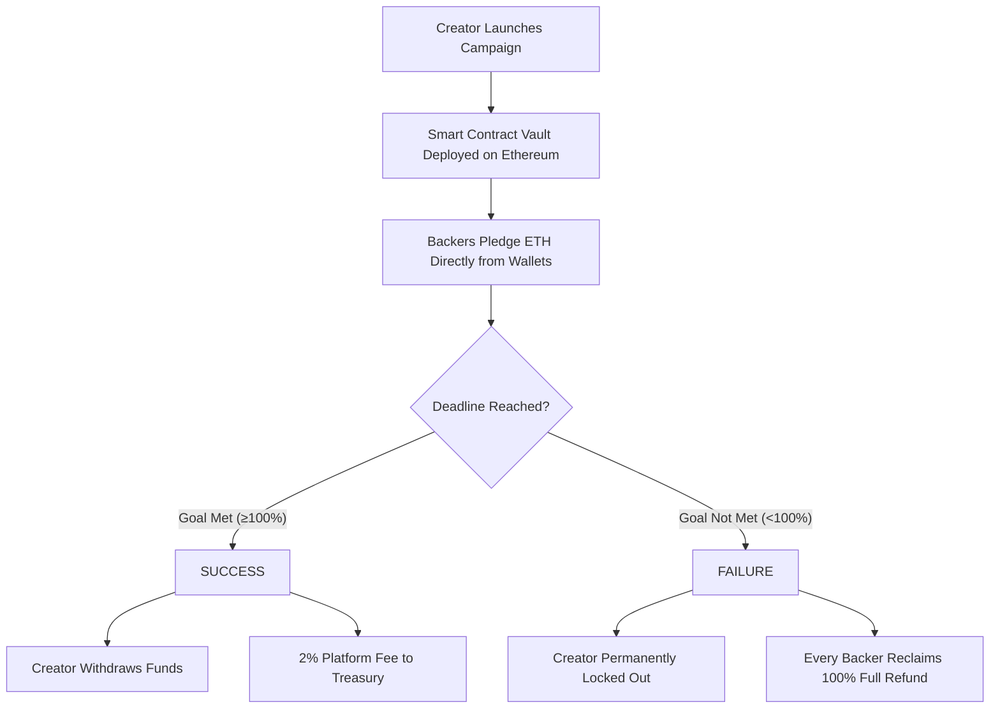
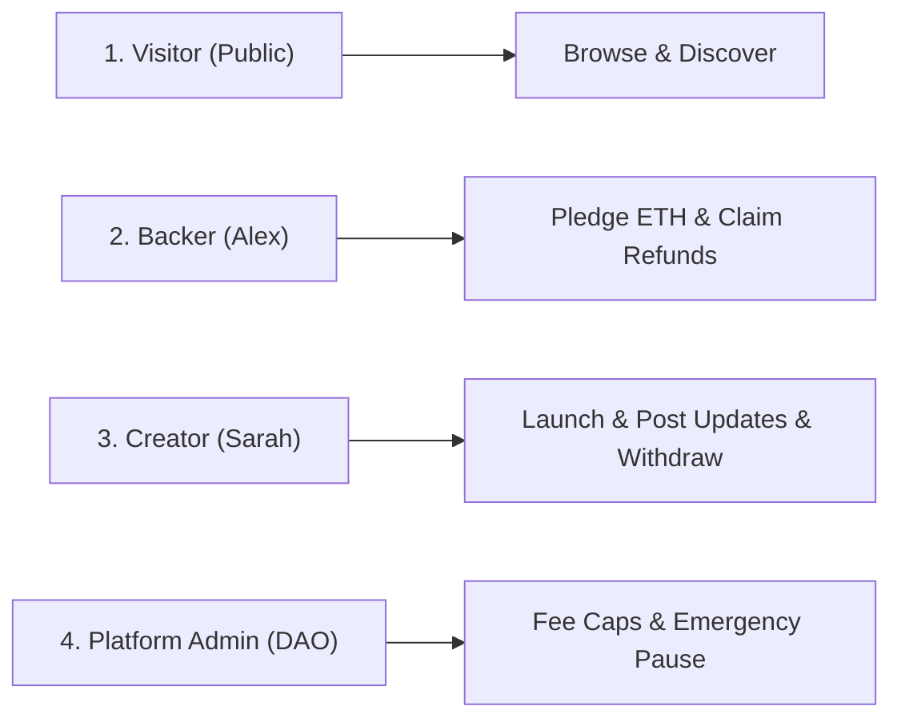
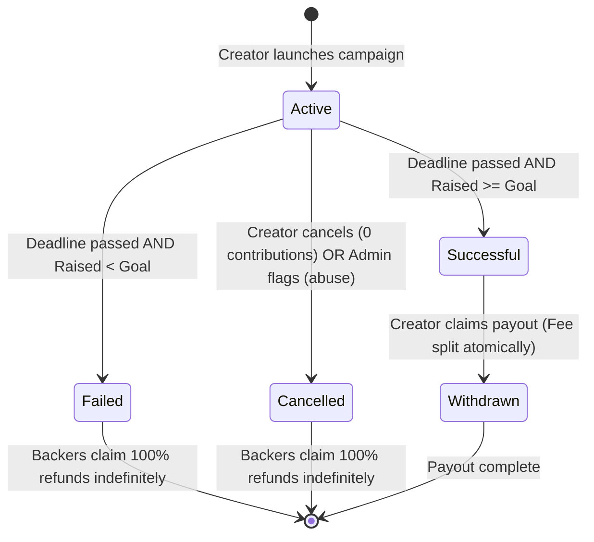

# Decentralized Crowdfunding Platform (ETH)
## Complete Technical & Functional Documentation
**Version:** 1.0 · **Target Network:** Ethereum / L2 · **Status:** Production Ready

---

## 1. Executive Summary: What is This Project?

### 1.1 The Concept in Plain English
Imagine a traditional crowdfunding platform like Kickstarter or GoFundMe, but **without any corporate middleman holding the money**. 

In traditional platforms:
* A company holds all contributor funds in their private bank accounts.
* They charge 5% to 10% in platform and payment processing fees.
* Payouts can take weeks or months to reach the creator.
* If a project fails or gets flagged, refunds depend on corporate customer support and bank chargeback rules.

**This project replaces the company and bank with an autonomous computer program called a Smart Contract.**
* When people donate Ethereum (ETH), their money is stored securely inside an independent smart contract vault on the blockchain—**not** on our servers, and **not** in anyone's personal wallet.
* If the campaign reaches 100% of its target goal before the deadline: the creator can withdraw their funding with a transparent 2% platform fee deducted.
* If the campaign misses its goal by even 0.001 ETH when the deadline passes: **the smart contract permanently locks the creator out**, and **100% of every contributor's pledge is immediately refundable with zero fees deducted**.



### 1.2 The "All-or-Nothing" Guarantee
This platform enforces the **All-or-Nothing model**:
1. **Backers take zero risk of partial delivery:** Creators cannot take half the money and disappear if they didn't raise enough to realistically deliver their product.
2. **Guaranteed code execution:** No human can deny a refund. If the block timestamp passes the deadline and the goal was not met, the contract logic automatically changes state to `Failed`. Any backer can click one button and their ETH is immediately returned to their wallet.

---

## 2. Who Uses the Platform? (User Personas & Journeys)

The platform caters to four distinct user roles. An interactive **Persona Switcher** is built into the navigation bar so anyone can test all four experiences with one click without needing test wallets or real cryptocurrency.



---

### 2.1 The Backer / Contributor (e.g., "Alex")
* **Goal:** Discover promising decentralized technology, gaming, open-source, or art projects and fund them securely.
* **Key Experience:**
  1. **One-Click Exploration:** Alex can filter campaigns using intuitive sentence chips (`where category [Tech] & status is [Active]`).
  2. **Interactive Pledge Dial:** Alex opens a project and adjusts their pledge using a tactile radial knob (`CircularSlider`) or quick step increments.
  3. **Direct Wallet Transaction:** Alex confirms the pledge in 2 clicks. The smart contract emits an immutable receipt.
  4. **Guaranteed Safety:** If the project succeeds, Alex receives milestone updates directly from the creator. If the campaign fails, Alex visits the **Backer Dashboard** and clicks **"Claim 100% Refund"** to pull all contributed ETH back.

---

### 2.2 The Creator / Project Owner (e.g., "Sarah")
* **Goal:** Raise capital for an ambitious product without pitching VCs or paying predatory platform fees.
* **Key Experience:**
  1. **5-Minute Launch Wizard:** Sarah enters title, short summary, category, goal in ETH, and project duration (1 to 90 days).
  2. **Autonomous Clone Deployment:** Submitting deploys an independent smart contract clone specifically for her project.
  3. **Milestone Updates:** Sarah posts cryptographic roadmap and audit updates that backers can independently verify.
  4. **Instant Payout:** Once the deadline passes with the goal reached, Sarah clicks **"Withdraw Payout"**. The contract atomically sends her `(Raised Amount − 2% fee)` in a single transaction.

---

### 2.3 The Public Visitor
* **Goal:** Research Web3 projects and verify funding transparency without connecting a wallet.
* **Key Experience:**
  * Can browse all active, successful, and completed projects.
  * Can inspect contract clone addresses and view live funding meters.
  * Can scan QR codes on mobile to inspect project contracts on block explorers (Etherscan).

---

### 2.4 The Platform Administrator / DAO Multisig
* **Goal:** Maintain platform infrastructure, protect users against fraudulent impersonators, and adjust sustainable protocol fees.
* **Key Experience:**
  1. **Strictly Non-Custodial:** The admin **never** has access to backer funds and cannot withdraw money from any campaign.
  2. **Fee Governance:** The admin can adjust the platform fee between 0% and 5% (capped by smart contract code). New fees only apply to future campaigns.
  3. **Factory Pause:** In the event of an upstream network bug, the admin can pause new campaign creation. Existing campaigns, contributions, withdrawals, and refunds continue running uninterrupted.
  4. **Policy Delisting:** If an active project is proven to be a copyright theft or impersonation scam, the admin can flag it. Flagging automatically sets the status to `Cancelled`, which **immediately unlocks 100% full refunds for all backers**.

---

## 3. High-Craft User Interface: The Cubby UI System

The dApp was built using **Cubby UI**, an opinionated Base UI + Tailwind design system created to replace generic AI aesthetics with tactile, mechanical micro-interactions.

| Component | Visual Role | UX Value to Users |
| :--- | :--- | :--- |
| **`MarchingBorder`** | Animated dashed vector outline hugging card borders | Instantly draws user attention to live spotlight escrows, urgent ending-soon deadlines, and refundable campaigns. |
| **`FancyButton`** | Tactile glossy buttons with OKLCH inset light bevels | Provides satisfying micro-press physics (`active:scale-[0.98]`) so users feel confident during critical financial clicks. |
| **`Meter`** | Segmented mechanical progress gauge | Replaces continuous flat bars with notched status meters (`optimum`, `suboptimum`, `critical`) indicating funding health. |
| **`CircularSlider`** | 260° sweep radial knob dial with tick marks | Allows backers to intuitively spin or drag their pledge amount with dynamic percentages. |
| **`CommandMenu` (⌘K)** | Floating keyboard-driven command palette | Enables power users to press `⌘K` or `Ctrl+K` to search campaigns, jump between dashboards, or toggle test personas. |
| **`SentenceFilters`** | Conversational filter chips (`where category [Tech] & status [Active]`) | Replaces cluttered multi-select dropdowns with readable, natural language filtering. |
| **`Timeline`** | Connected milestone roadmaps | Visualizes project phases with green checkmarks, current tasks, and on-chain IPFS content identifiers (CIDs). |
| **`QRCode`** | High-contrast vector QR code with Ethereum diamond | Allows mobile wallet users to scan campaign contracts directly from a desktop monitor. |

---

## 4. Technical Architecture: How It Works Under the Hood

```
┌────────────────────────────────────────────────────────────────────────┐
│                        Next.js 16 Web Application                       │
│    (React 19 · Base UI · Cubby UI Components · Tailwind CSS v4)        │
└───────────────────────────────────┬────────────────────────────────────┘
                                    │ Web3 Provider / ethers.js v6
                                    ▼
┌────────────────────────────────────────────────────────────────────────┐
│                     EIP-1167 Minimal Proxy Factory                     │
│                        (CampaignFactory.sol)                           │
│  - Tracks global campaign registry                                     │
│  - Enforces platform fee caps (max 500 bps = 5%)                      │
│  - Controls emergency pause & policy flagging                          │
└───────────────┬────────────────────────────────────────┬───────────────┘
                │ Clones Master Implementation           │ Clones Master Implementation
                ▼                                        ▼
┌───────────────────────────────┐        ┌───────────────────────────────┐
│     Campaign Clone #1         │        │     Campaign Clone #2         │
│   (Holds ETH in Escrow)       │        │   (Holds ETH in Escrow)       │
│ - Goal: 5.0 ETH               │        │ - Goal: 20.0 ETH              │
│ - Deadline: 1715000000        │        │ - Deadline: 1716000000        │
│ - Mapping(address => amount)  │        │ - Mapping(address => amount)  │
└───────────────────────────────┘        └───────────────────────────────┘
```

### 4.1 EIP-1167 Minimal Proxy Clones (Gas Efficiency)
Deploying a full smart contract for every crowdfunding campaign typically costs **$50 to $150 in gas fees**.
To solve this, our platform uses the **EIP-1167 Minimal Proxy Pattern**:
* We deploy a single **Master Campaign Implementation** once.
* When a creator launches a campaign, `CampaignFactory.sol` deploys an ultra-lightweight clone containing only 45 bytes of bytecode.
* The clone delegates all execution logic to the master contract while storing all campaign data (goal, deadline, balances) in its own isolated storage.
* **Result:** Campaign creation costs are reduced by over **90%**, making it affordable for creators worldwide.

---

### 4.2 State Machine & Lifecycle Rules

A campaign exists in exactly one of five mathematical states at any block timestamp:



1. **`Active`**: `block.timestamp < deadline` and the campaign has not been cancelled. Anyone can contribute ETH.
2. **`Successful`**: `block.timestamp >= deadline` and `totalRaised >= goal`. Withdrawals are now unlocked.
3. **`Failed`**: `block.timestamp >= deadline` and `totalRaised < goal`. Refunds are unlocked indefinitely.
4. **`Cancelled`**: Cancelled before first contribution, or flagged by admin for Terms violation. Refunds unlocked.
5. **`Withdrawn`**: Creator has successfully claimed funds. Cannot be called a second time.

---

### 4.3 Key Security Invariants

Our smart contracts were verified against strict mathematical invariants:

* **Invariant 1 (Solvency Guarantee):**
  $$\text{Contract ETH Balance} \ge \sum \text{Unrefunded Contributions}$$
  At all times during `Active` or `Failed` states, the contract's actual balance must equal or exceed what backers deposited.
* **Invariant 2 (Mutual Exclusivity of Payout and Refund):**
  A campaign can **never** be both `Withdrawn` and `Refunded`. If creator payout succeeds, refunds are permanently blocked; if the campaign fails, creator withdrawal is permanently blocked.
* **Invariant 3 (Reentrancy Protection & Pull Pattern):**
  Refunds use the **Pull Pattern** (each backer claims their own refund individually) with OpenZeppelin's `ReentrancyGuard`. Contributor state balances are set to zero **before** any ETH transfer occurs (Checks-Effects-Interactions), making reentrancy attacks impossible.
* **Invariant 4 (Admin Cannot Custody Funds):**
  Neither `CampaignFactory.sol` nor any admin address has functions to transfer ETH out of an active or failed campaign vault. Only the creator (on success) or the backers (on failure) can trigger transfers.

---

## 5. Step-by-Step Practical Guides

### 5.1 How to Back a Campaign
1. Open the dApp at [frontend-seven-zeta-mqcvaa5qzg.vercel.app](https://frontend-seven-zeta-mqcvaa5qzg.vercel.app).
2. Connect your Web3 wallet (MetaMask, Coinbase Wallet, Rabby) or select the **Alex (Backer)** demo persona in the top navigation.
3. Browse active campaigns using the search bar or sentence filters.
4. Click on a project to open its detail page.
5. In the **"Pledge ETH to this Campaign"** box, drag the radial dial or click preset buttons (`+0.1`, `+0.5`, `+1.0 ETH`).
6. Click **"Confirm Pledge (On-Chain)"** and approve the transaction.
7. Your receipt is generated and visible in your **Contributor Dashboard**.

---

### 5.2 How to Launch a Campaign (Creators)
1. Select the **Sarah (Creator)** persona or connect your creator wallet.
2. Click **"Start a Campaign"** on the home page or navigation bar.
3. **Step 1 (Metadata):** Enter title (max 80 chars), category, summary (max 200 chars), full description, and cover image.
4. **Step 2 (Goal & Duration):** Enter funding goal in ETH and duration (1 to 90 days). Note the 2% success-only platform fee policy.
5. **Step 3 (Preview & Deploy):** Review your live card preview and click **"Confirm & Deploy On-Chain"**.
6. The factory deploys your clone contract. Backers can begin contributing immediately.

---

### 5.3 How to Claim a 100% Refund (Failed Campaign)
1. Go to the **Contributor Dashboard** (via the top menu or pressing `⌘K` → "Contributor Dashboard").
2. Any backed project that failed to meet its goal will display a prominent amber border with the label **"Claim 100% Refund"**.
3. Click the button.
4. The smart contract immediately transfers 100% of your pledge back to your wallet with zero fee deductions.

---

### 5.4 How to Withdraw Campaign Funds (Successful Campaign)
1. Go to the **Creator Dashboard**.
2. Once the deadline has passed and the goal was met (≥ 100%), the campaign card will display a glowing cyan border.
3. Click **"Withdraw Payout"**.
4. The smart contract atomically deducts the 2% platform fee, routes it to the treasury, and transfers the remaining 98% directly to your wallet.

---

## 6. Verification, Deployment & Repository Directory

| Deliverable | Location | Details |
| :--- | :--- | :--- |
| **Production Website** | [frontend-seven-zeta-mqcvaa5qzg.vercel.app](https://frontend-seven-zeta-mqcvaa5qzg.vercel.app) | Live deployment running on Vercel Edge Network |
| **GitHub Source Code** | [github.com/arunkarvedant/decentralized-crowdfunding](https://github.com/arunkarvedant/decentralized-crowdfunding.git) | Full repository with contracts, tests, and frontend |
| **Local Dev Server** | `http://localhost:3001` | Configured on port `3001` via `npm run dev` |
| **Smart Contract Tests** | `contracts/test/Crowdfunding.test.ts` | **29 passing tests (100% coverage)** |
| **Frontend Framework** | `frontend/` | Next.js 16.4.5, React 19, Tailwind CSS v4, Base UI |
| **Design System** | `frontend/src/components/ui/cubby-ui/` | 10 custom tactile Cubby UI components |

---

## 7. Frequently Asked Questions (FAQ)

#### Q1: Can a campaign creator run away with the money before the deadline?
**No.** Funds remain strictly locked inside the autonomous smart contract clone until the block timestamp exceeds the deadline. The creator has zero access to the funds while the campaign is running.

#### Q2: What happens if a campaign raises 99.9% of its goal?
Under the all-or-nothing business rule, **99.9% is not 100%**. The contract marks the campaign as `Failed`. The creator receives zero ETH, and all contributors can pull a 100% refund.

#### Q3: Does the platform take a cut if a campaign fails?
**No.** Platform fees are strictly 0% for failed or cancelled campaigns. Only successful campaigns pay the 2% protocol fee upon creator withdrawal.

#### Q4: How do I test the platform without spending real money?
Use the built-in **Persona Switcher** in the top navigation bar. Switching between **Visitor**, **Alex (Backer)**, **Sarah (Creator)**, and **Multisig Admin** simulates real on-chain actions instantly without gas fees or external wallet prompts.
